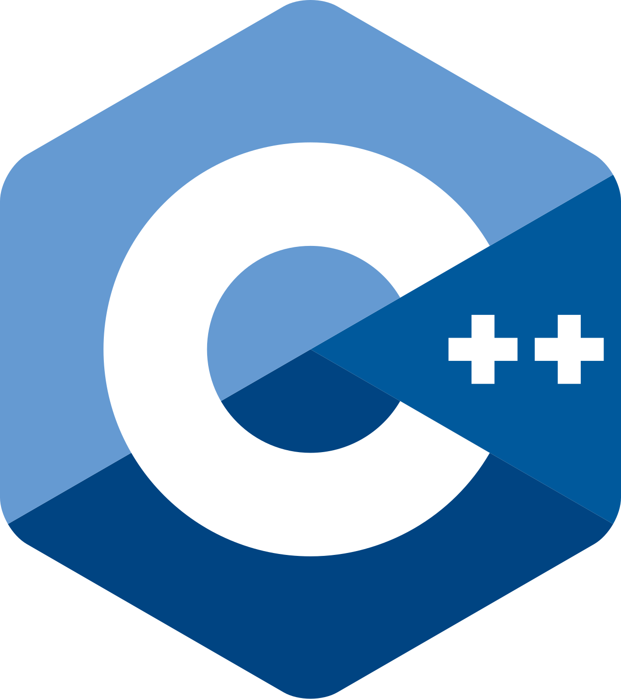
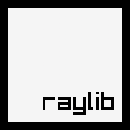
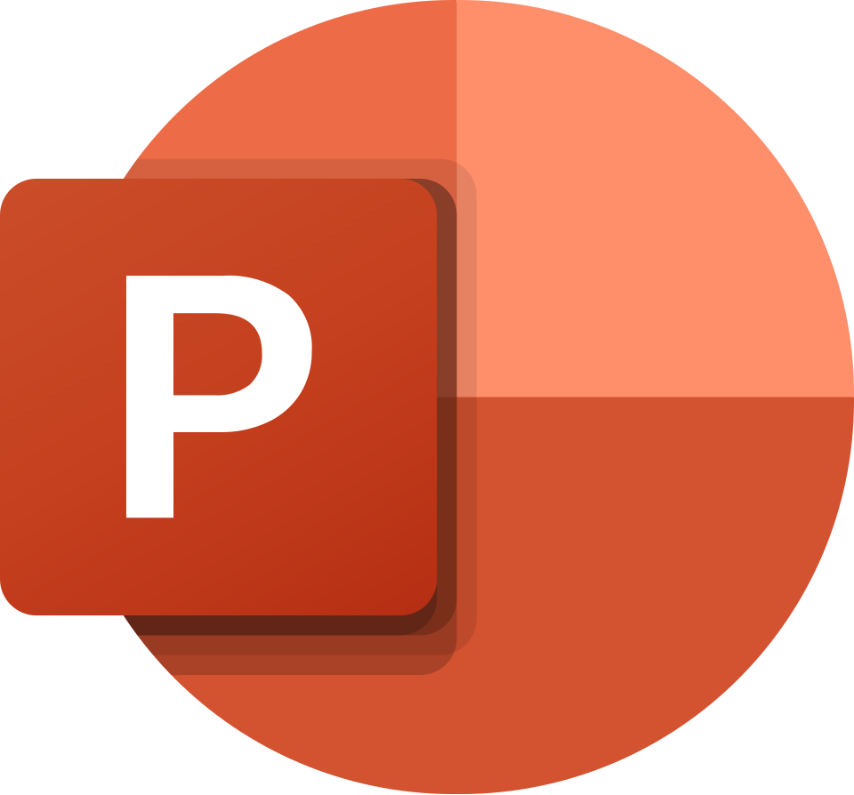
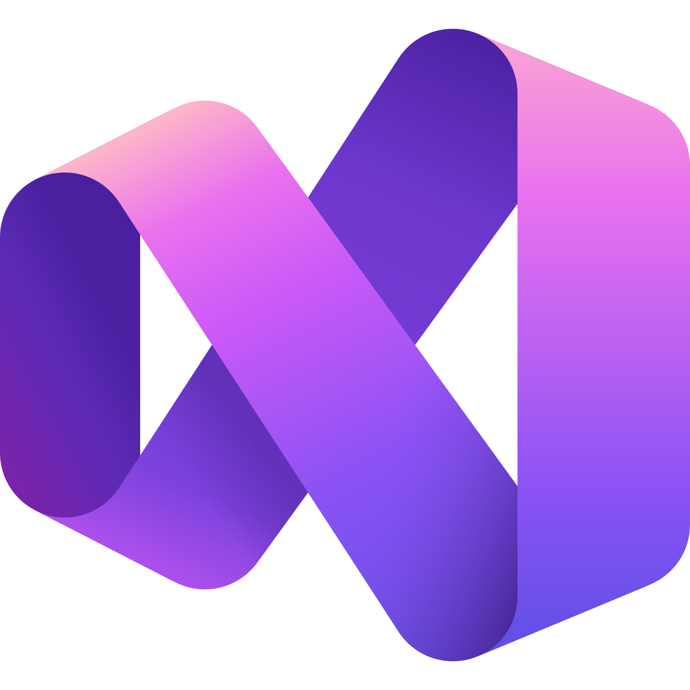
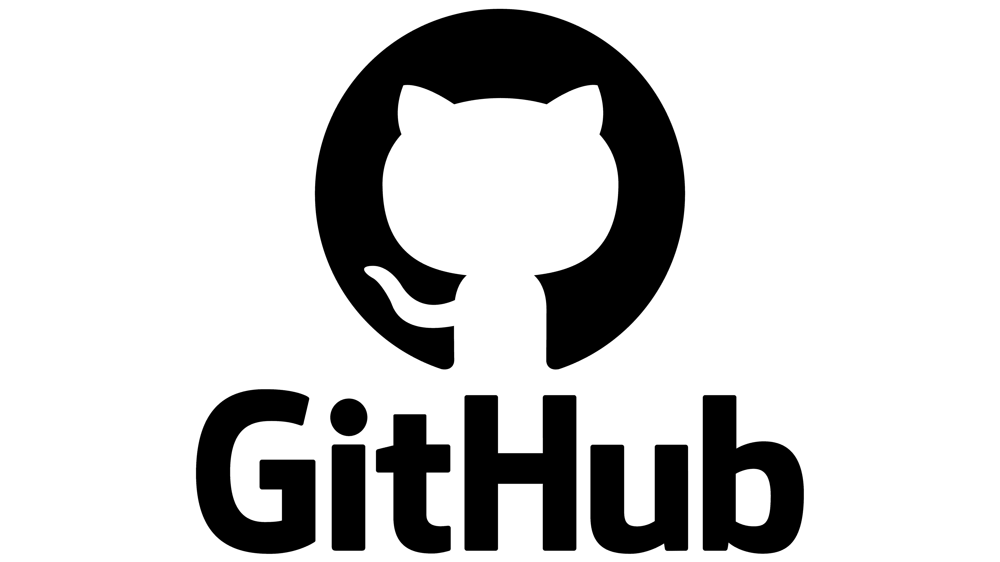

<h1 align="center">Cyberpunks</h1>
 
<br>
<p>Hello, we are Cyberpunks!</p>
<p>We are Team Cyberpunks, a squad of young, driven programmers taking on the ultimate challenge: building a fully functional labyrinth game from scratch using C++ in Visual Studio.

Armed with logic, algorithms, and a lot of caffeine, our mission is to turn complex code into an immersive puzzle experience. Every wall we build, every path we generate, and every line of debugging brings us one step closer to mastering the maze.

Step into our code, navigate the twists and turns, and watch how the Cyberpunks bring the labyrinth to life!</p>
<br>
 
<h2 align="left">🚀 Languages and Libraries </h2>
<p align="left">
<a href="https://cplusplus.com"></a>
<a href="https://www.raylib.com"></a>
</p>
 
<h2 align="left">🔧 Used Tools </h2>
<p align="left">
   
   
   
   
   
 <br>
 
<h2 align="left">📄 Documents</h2><br>
  <ul>
    <li><a href="Documentation/Cyberpunks_Documentation.docx">Documentation</a></li>
    <li><a href="Documentation/Cyberpunks_Presentation.pptx
">Presentation</a></li>
  </ul>  
 
<h2 align="left">👨🏻💻 Team Members </h2>
<table >
  <tr>
    <td align="center">Name</td>
    <td align="center">Role</td>
    <td align="center">Grade</td>
    <td align="center">Github</td>
  </tr>
    <tr>
    <td align="center">Zlatin Kostov</td>
    <td align="center">Scrum Trainer</td>
    <td align="center">🟨 9A</td>
    <td align="center"> <a href="https://github.com/ZDKostov24">ZDKostov24 </a></td>
  </tr>
  <tr>
    <td align="center">Maksim Iliev</td>
    <td align="center">Backend developer</td>
    <td align="center">🟩 9V</td>
    <td align="center"> <a href="https://github.com/MaxIliev27">MaxIliev27 </a></td>
  </tr>
  <tr>
    <td align="center">Iliyan Iliev</td>
    <td align="center">Frontend developer</td>
    <td align="center">🟩 9V</td>
    <td align="center"> <a href="https://github.com/IHIliev24">IHIliev24 </a></td>
  </tr>

  <tr>
    <td align="center">Kristian Dinev</td>
    <td align="center">QA</td>
    <td align="center">🟥 9B</td>
    <td align="center"> <a href="https://github.com/KMDinev24">KMDinev24 </a></td>
  </tr>
  </table>
<br>
 
 <h2 align="left">🔑 Access</h2>
 
 <p> Open cmd and clone our repo by typing</p>
 
```
https://github.com/ZDKostov24/Cyberpunks.git
```
